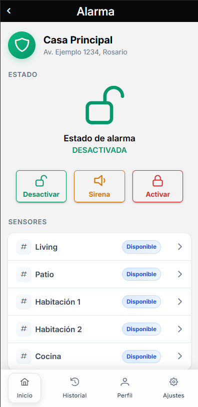
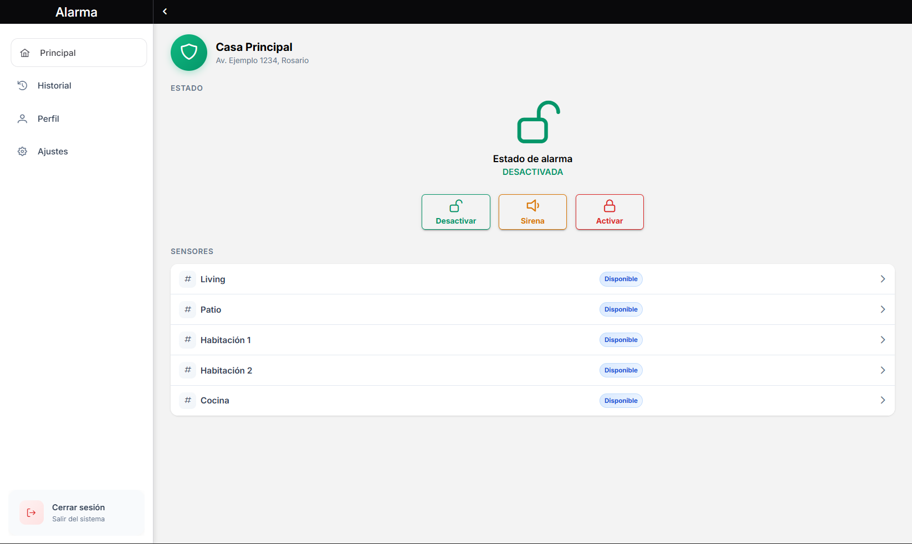
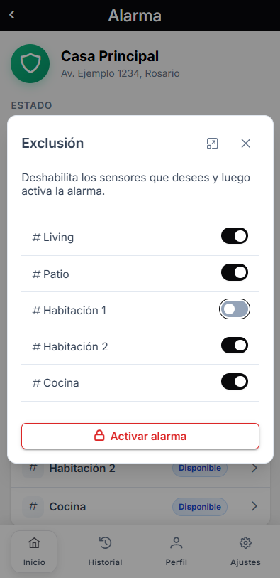
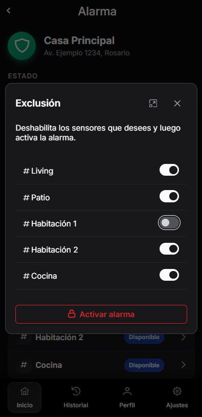
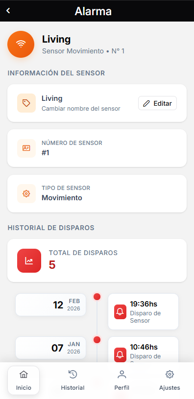
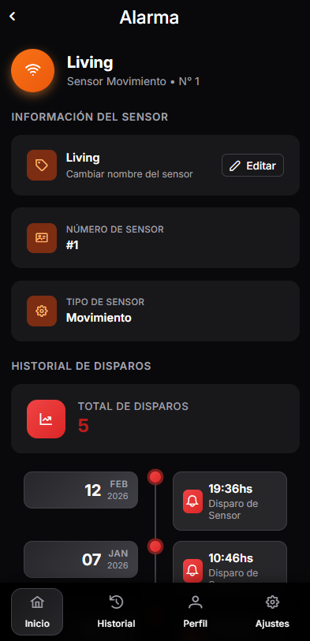

# Sistema de Alarmas - (Frontend)

Aplicación frontend para un **sistema de alarmas domóticas**, desarrollada con **Angular** y desplegable tanto como **aplicación web** como **app móvil** mediante Capacitor.

La aplicación permite a los usuarios **monitorear, controlar y configurar** sus sistemas de alarma en tiempo real desde una interfaz centralizada.

## Vista Previa

### Dashboard
<div align="center">
  
  
</div>

### Armado de alarma + Sensores
<div align="center">
  
  
  
  
</div>

## Acceso de demostración

URL: [alarmstech.vercel.app](https://alarmstech.vercel.app)

| Campo | Valor |
| --- | --- |
| Usuario | `demouser@example.com` |
| Contraseña | `Demouser` |

> *Algunas funcionalidades están restringidas para el usuario demo.*

## Descripción General

Este proyecto forma parte de un **ecosistema full stack de alarmas inteligentes**, donde:

* El **frontend** se encarga de la interfaz y la experiencia de usuario
* El **backend** gestiona la lógica de negocio y persistencia
* Los dispositivos se comunican mediante **MQTT**
* Las actualizaciones en tiempo real se manejan con **WebSockets**

El sistema está diseñado con foco en la **escalabilidad, modularidad y mantenibilidad**.

## Funcionalidades Principales

* 🔐 Autenticación completa (login, registro, verificación de email y recuperación de contraseña)
* 🏠 Gestión de múltiples hogares con hub de casas y cambio de casa activa
* 🚨 Control de la alarma: armar / desarmar ⏸️ con exclusión de sensores
* 🔊 Control manual de la sirena (activar / silenciar)
* 📡 Actualizaciones en tiempo real vía WebSocket (armado, disparos y advertencias)
* 🔔 Notificaciones de eventos y alertas in-app
* 📜 Historial de eventos de la central (global y por sensor)
* 🔧 Gestión y renombrado de sensores
* 👤 Perfil de usuario con edición de datos y cambio de contraseña
* 🏷️ Edición de datos del hogar y código de alarma
* 🌓 Modo claro / oscuro configurable (preferencias del usuario)
* 🔗 Deep links desde emails (verificación y recuperación)
* 📱 Soporte mobile mediante Capacitor

## Arquitectura

La aplicación sigue una **arquitectura basada en features**, con una clara separación de responsabilidades.

```
src/app/
│
├── auth/                        → Funcionalidad de autenticación
│   ├── pages/                   → login, register, verify-email, forgot-password, reset-password
│   ├── components/              → logo, send-email-form
│   ├── services/                → auth.service (HTTP)
│   ├── guards/                  → auth.guard
│   ├── interfaces/              → tipados del dominio auth
│   └── utils/                   → validaciones de formularios
│
├── dashboard/                   → Aplicación principal (zona protegida)
│   ├── pages/                   → home, hub, sensor, central-history, profile, house-info, preferences
│   ├── components/              → arm-action, sensor-list, house-card, nav-bar, side-bar, modals, etc.
│   ├── services/                → current-house, current-user, house, sensor, central, profile, alert, active-route
│   ├── guards/                  → dashboard.guard
│   ├── interceptors/            → token.interceptor (Authorization Bearer)
│   └── interfaces/              → alarm, sections, websockets
│
└── shared/                      → Lógica y UI reutilizables entre features
    ├── components/              → logout-modal
    ├── services/                → socket, toast, theme
    ├── interfaces/              → domain, dto, api-models, UI
    ├── utils/                   → mappers, jwt, api-errors, regular-expressions
    └── constants.ts             → rutas y eventos de WebSocket
```

### Principios Clave

* **Aislamiento por feature**
* **Patrón Component → Service**
* **Responsabilidad única por capa**
* **Reutilización de lógica común**
* **Estructura escalable**

### Flujo de datos

* **HTTP** → Component → Service → API → Service → Signals → UI
* **WebSocket** → Socket.IO (solo en `SocketService`) → Services → Signals → UI

*Las Signals son la única fuente de verdad del estado; RxJS se usa solo para HTTP, WebSockets y flujos asincrónicos.*

## Stack Tecnológico

* **Angular 19** (standalone components, zoneless change detection, `OnPush`)
* **Angular Signals** para estado reactivo interno
* **RxJS** para HTTP, WebSockets y flujos asincrónicos
* **PrimeNG 19 + PrimeIcons** para componentes de UI
* **TailwindCSS** para estilado utilitario
* **SCSS** para estilos globales y temas
* **Socket.IO Client** para actualizaciones en tiempo real
* **Capacitor 7** para build Android
* **Lodash** para utilidades
* **Vitest** para testing unitario
* **ESLint (ts-standard) + Prettier** para linting y formato

## Comunicación en Tiempo Real

El frontend se integra con sistemas en tiempo real mediante:

* **WebSockets (Socket.IO)** → actualización de la UI
* **MQTT (a través del backend)** → comunicación con dispositivos

Socket.IO se maneja exclusivamente en `shared/services/web-socket.service.ts`, y las alertas (`alarm/arming`, `alarm/triggered`, `alarm/warning`) se sincronizan con las Signals a través de `AlertService` y `CurrentHouseService`.

### Flujo típico

1. El usuario ejecuta una acción (ej: activar alarma)
2. Se envía un request HTTP al backend
3. El backend publica un mensaje MQTT
4. El dispositivo responde
5. El backend emite un evento por WebSocket
6. El frontend actualiza la interfaz en tiempo real

## Desarrollo Asistido por IA

El proyecto incluye soporte para desarrollo asistido mediante agentes de IA, definido en:

* `AGENTS.md`
* Carpeta `.opencode/skills/`

### Sistema de Skills

Se define un conjunto de **skills de desarrollo** para asegurar consistencia:

* State Management (Signals)
* HTTP Communication and Data Handling
* WebSocket Integration
* Forms Handling
* Routing and Navigation
* Error Handling and UX Feedback
* Architecture Enforcement
* Angular Testing (Vitest)

Estas reglas garantizan que el código:

* Sea consistente con la arquitectura
* Evite anti-patrones
* Sea escalable

## Configuración de Entorno

La aplicación maneja los entornos mediante `fileReplacements` de Angular:

- `src/app/env.ts` → entorno de desarrollo (usado por `ng serve`)
- `src/app/env.prod.ts` → entorno de producción (usado por `ng build --configuration production`)

```ts
export const ENV = {
  API_URL: 'https://<DOMINIO>:<PUERTO>/api-alarma',
  SOCKET_URL: 'https://<DOMINIO>:<PUERTO>',
  WEB_APP_URL: 'https://<DOMINIO>'
};
```

Las constantes que no dependen del entorno (ruta del socket, eventos WebSocket, etc.) viven en `src/app/shared/constants.ts`.

## Integración con Backend

Este frontend está diseñado para integrarse con un backend que incluye:

* API REST (Express + MongoDB)
* WebSockets (Socket.IO)
* Broker MQTT (Mosquitto)

## Testing

Las pruebas unitarias se ejecutan con **Vitest**, integrado con Angular mediante `@analogjs/vitest-angular` (plugin de Vite + setup del TestBed), en reemplazo de Karma/Jasmine.

### Configuración

Definida en `vite.config.ts`:

* `environment: 'jsdom'` → los specs corren en un DOM simulado
* `globals: true` → APIs de Vitest (`describe`, `it`, `expect`) disponibles sin imports
* `setupFiles: ['src/test-setup.ts']` → carga el setup de TestBed antes de cada suite

En `src/test-setup.ts` se ejecuta `setupTestBed({ zoneless: true })` y se aplica un shim de compatibilidad entre AnalogJS y Angular 19.2 (mapeo de `provideExperimentalZonelessChangeDetection` → `provideZonelessChangeDetection`), además de resetear el `TestBed` después de cada test.

### Alcance

Los specs existentes organizados por feature:

* `app.component.spec.ts`
* `auth/` → componentes (`logo`)
* `dashboard/` → servicios (`profile`) y componentes/páginas (`house-card`, `disarm-action`, `profile`)
* `shared/` → servicios (`theme`, `toast`)

### Comandos

| Comando | Descripción |
| --- | --- |
| `npm test` | Ejecuta los tests una vez (`vitest run`) |
| `npm run test:watch` | Tests en modo watch (`vitest`) |

## Mejoras Futuras

* 📊 Dashboard con analíticas avanzadas
* 🔔 Notificaciones push nativas (las actuales son in-app en tiempo real vía WebSocket)
* 🌐 Soporte multi-idioma
* 🎨 Mejoras de UI/UX

## Autor

**Diego Salvañá**

*Desarrollador Frontend / Full Stack*
